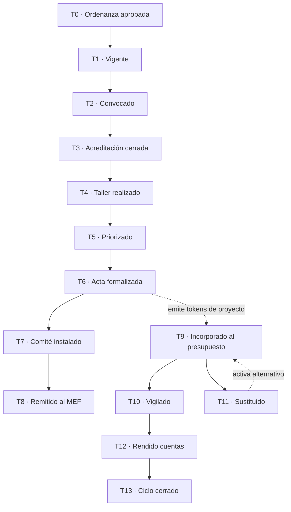

# Máquina de estados del ciclo del presupuesto participativo

Especificación funcional derivada del marco normativo peruano y de las normas locales de las dos municipalidades piloto. Es la fuente de verdad del registro: el contrato y el contrato de datos la implementan, no la definen.

---

## 1. Para qué sirve este documento

El registro no almacena documentos: registra el estado de un proceso administrativo y rechaza las transiciones que la norma no permite. Para que eso sea posible hay que responder cuatro preguntas por cada paso del proceso: qué evento lo dispara, quién lo firma, qué documento lo acredita y qué regla debe cumplirse para que sea válido.

Este documento responde esas cuatro preguntas para las catorce transiciones del ciclo.

## 2. Modelo de dos niveles

El proceso tiene dos objetos con ciclos de vida distintos, y confundirlos es el error de modelado más común.

**El ciclo** es único por municipalidad y año fiscal. Nace con la norma que lo convoca y muere con la rendición de cuentas. Sus estados describen el avance del proceso participativo.

**El proyecto** es múltiple dentro de un ciclo. Nace cuando el Acta lo prioriza y muere cuando se ejecuta, se sustituye o se rinde cuenta de él. Sus estados describen el destino de cada compromiso.

Un ciclo puede estar en estado «formalizado» mientras sus proyectos están, unos incorporados al presupuesto y otros sustituidos.

## 3. Las transiciones

### Nivel ciclo

| # | Transición | Evento disparador | Quién firma | Evidencia | Base legal |
|---|---|---|---|---|---|
| T0 | ∅ → ordenanza aprobada | Sesión de concejo que aprueba el reglamento del proceso | Concejo municipal; promulga la alcaldía | Ordenanza, con su informe de sustento | Ley N.° 28056, art. 7; Ley N.° 27972, art. 9 |
| T1 | → vigente | Publicación de la norma | Secretaría general | Constancia del medio de publicación | Ley N.° 27972, art. 44 |
| T2 | → convocado | Convocatoria de la alcaldía como presidencia del consejo de coordinación local | Alcaldía | Convocatoria pública | Instructivo N.° 001-2010-EF/76.01, fase de preparación |
| T3 | → acreditación cerrada | Cierre del libro de registro de agentes participantes | Oficina de planeamiento y presupuesto | Lista pública de organizaciones acreditadas, sin datos personales | Reglamento local; D.S. N.° 142-2009-EF |
| T4 | → taller realizado | Taller de identificación y priorización | Equipo técnico | Matriz de criterios validada y lista de propuestas | Instructivo, fase de concertación |
| T5 | → priorizado | Evaluación técnica y cuadro de puntajes | Equipo técnico | Vector de criterios y puntaje por proyecto | Reglamento local, matriz de priorización |
| T6 | → acta formalizada | Suscripción del Acta de Acuerdos y Compromisos | Consejo de coordinación local y agentes participantes | Acta, versión pública | Ley N.° 28056, art. 7; reglamento local |
| T7 | → comité instalado | Elección del comité de vigilancia por los agentes | Agentes participantes | Acta de elección; claves de rol registradas | Instructivo, cap. III |
| T8 | → remitido al MEF | Remisión del informe final y registro en el aplicativo | Oficina de planeamiento y presupuesto | Constancia del aplicativo y oficio de remisión | Instructivo, registro del proceso |

### Nivel proyecto

| # | Transición | Evento disparador | Quién firma | Evidencia | Base legal |
|---|---|---|---|---|---|
| T9 | → incorporado al presupuesto | Aprobación del presupuesto institucional de apertura | Concejo municipal | Acuerdo o presupuesto aprobado, con el código único de inversiones | Ley N.° 28056, art. 7; D. Leg. N.° 1440 |
| T10 | → vigilado | Informe del comité de vigilancia | Comité de vigilancia | Informe | Instructivo, cap. III |
| T11 | → sustituido | Imposibilidad de ejecutar un proyecto priorizado | Alcaldía, con aviso al consejo de coordinación local y al comité | Resolución de alcaldía, nota modificatoria presupuestal y constancia de aviso | Instructivo, regla de sustitución; reglamento local |
| T12 | → rendido cuentas | Rendición de cuentas en el ciclo siguiente | Alcaldía y comité | Informe de rendición | Ley N.° 28056, art. 7 |
| T13 | ciclo → cerrado | Culminación de los proyectos del ciclo | Comité de vigilancia | Balance del ciclo | Reglamento local, vigencia del comité |

### Diagrama

## 4. Las guardas

Una guarda es una condición que el contrato verifica antes de aceptar una transición. Si no se cumple, la transacción falla en la red.

| Guarda | Qué impide | Fundamento |
|---|---|---|
| G1 | Cualquier transición sin un ciclo abierto previamente | Sin norma que convoque el proceso, ningún acto posterior tiene sustento |
| G2 | Abrir dos veces el mismo ciclo | La clave combina código territorial, número de norma y año fiscal. Dos municipalidades emiten normas con el mismo número el mismo año |
| G6 | Confiar en la fecha declarada | El contrato compara la fecha del acto con la marca de tiempo del ledger y marca el registro como retroactivo cuando corresponde |
| G7 | Rechazar actos anteriores a la vigencia | Emite alerta y acepta la transición: el registro documenta hechos, no dictamina su legalidad. Rechazar rompería la completitud de la serie |
| G8 | Que una misma clave represente al comité de vigilancia y al consejo de coordinación local | El cargo en el comité es incompatible con la representación ante el consejo |
| G9 | Firmar sin el quórum del comité | Cuatro miembros, umbral de tres mientras no se conozca su reglamento interno |
| G10 | Puntajes inválidos o sustituciones fuera de la escala | El contrato recalcula la suma del vector de criterios y exige que la sustitución elija al alternativo de mayor rango disponible |
| G11 | Incorporar al presupuesto sin código único de inversiones | Sin ese código la inversión no existe para el sistema de programación multianual |
| G12 | Cerrar un ciclo sin que el siguiente esté abierto | La rendición de cuentas ocurre dentro del proceso participativo del año siguiente |

## 5. Reglas de la sustitución (T11)

La sustitución es la transición de mayor riesgo, porque altera lo que los vecinos acordaron. Siete condiciones deben cumplirse simultáneamente:

| Regla | Condición |
|---|---|
| R1 | El proyecto saliente está en estado «incorporado al presupuesto» |
| R2 | Existe el acto que motiva la sustitución, anclado por su huella |
| R3 | El proyecto entrante pertenece a la lista alternativa del Acta y respeta la escala de prioridades |
| R4 | La alcaldía firma la transición |
| R5 | Consta el aviso al consejo de coordinación local y al comité de vigilancia |
| R6 | Consta la nota modificatoria presupuestal |
| R7 | El índice de la serie es consecutivo, sin saltos |

**Límite conocido:** la matriz de priorización no define regla de desempate. Si dos alternativos tienen el mismo puntaje, elegir al segundo exige motivo anclado y firma del comité.

## 6. Dos variantes de génesis

El modelado de ambas municipalidades mostró que la apertura del ciclo no siempre tiene una sola pieza.

**Variante A, ordenanza única.** La ordenanza aprueba el reglamento, convoca el proceso y contiene el cronograma como anexo. Es el caso de la Municipalidad Provincial de Tocache.

**Variante B, ordenanza marco más decreto anual.** Una ordenanza marco aprueba el reglamento y delega en un decreto de alcaldía la convocatoria y el cronograma de cada año. Es el caso de la Municipalidad Distrital de La Punta, cuyo reglamento lo establece en su artículo 18.

La máquina de estados admite ambas: en la variante B, T0 ancla las huellas de las dos normas, y las modificaciones posteriores del cronograma se registran como versiones sucesivas sin retroceder el estado del ciclo.

Esta variante probablemente sea la regla y no la excepción en municipios con ordenanza marco, de modo que el contrato debe tratarla como caso normal.

## 7. Qué no decide este documento

La especificación define qué debe ocurrir, no cómo se implementa. Quedan abiertas, para la revisión técnica:

- qué estados conviene guardar en almacenamiento persistente y cuáles solo por su huella, dado el costo de la renta de estado;
- si el vector completo de criterios se almacena o solo su total y su huella;
- si conviene un contrato por ciclo o uno solo con muchas entradas;
- qué guardas no son verificables con los datos que el contrato tiene a mano, y qué alternativa proponer para cada una.

Las respuestas a estas preguntas pueden modificar el diseño. Las reglas que provienen de la norma, en cambio, no se negocian por conveniencia de implementación: si una guarda no es implementable como está planteada, se busca otra forma de cumplirla.

## 8. Cómo se cambia esta especificación

Quien implementa puede y debe proponer cambios. La ruta es una propuesta de cambio en el repositorio que explique qué no funciona y qué alternativa se propone. La dueña de producto aprueba o rechaza. No se modifica por edición directa.

---

## Autoría y método

Diseño de **Nadinne Canto Novoa**, dueña de producto, a partir de la lectura de la Ley N.° 28056 y sus modificatorias, el D.S. N.° 142-2009-EF, el Instructivo N.° 001-2010-EF/76.01, la Ordenanza Municipal N.° 001-2026-MPT de la Municipalidad Provincial de Tocache y el Decreto de Alcaldía N.° 002-2026-MDLP/AL de la Municipalidad Distrital de La Punta.

La redacción y la estructuración de este documento se elaboraron con asistencia de Claude, de Anthropic, bajo dirección, criterio y validación de TechGob. Las fuentes normativas fueron leídas y verificadas en sus textos oficiales; las afirmaciones sobre el contenido de las normas municipales provienen de los documentos publicados por cada entidad.

La revisión de implementabilidad técnica corresponde a quien desarrolla, y sus aportes quedan registrados en el historial de versiones de este repositorio.
